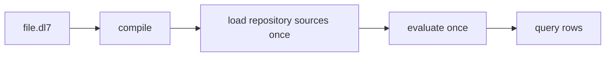

# One query over a repository

## Intuition

`dl8 query` answers one question about one repository and then exits. It compiles the DL7 file. It loads the requested repository sources once. It settles the evaluator. It prints the resulting rows.



No watcher remains after the command exits. No view is stored.

## A tracked file query

A relation declares the shape of its rows. A rule derives new rows from rows that already exist. The `File` rule below derives one path from each tracked file at `HEAD`.

```dl7
; fixture: book/src/probes/26_query.dl7
; expect: rc=0
; List every tracked path at HEAD.
(fs: (import "@std/fs"))

(: File (* (: path str)))

(<- (File ?Path)
    (fs.at "." "HEAD" ?Path ?Blob))
```

The repository root comes from `--repo`. The current directory is the default root.

```console
$ d=$(mktemp -d) && git -C "$d" init -q -b main && printf 'alpha\n' > "$d/a.txt" && printf 'beta\n' > "$d/b.txt" && git -C "$d" add a.txt b.txt && git -C "$d" -c user.name=dl8 -c user.email=dl8@example.invalid commit -q -m files && $DL8 query book/src/probes/26_query.dl7 --repo "$d" --format table
(File "a.txt")
(File "b.txt")
```

## Printed rows

DL7 has no query marker. The command prints every derived relation declared by the root module. Imported source relations provide input rows and stay out of the result.

`--format table` prints a relation table for reading in a terminal. `--format json` prints the same rows as structured data for another process.

## Engines

`DL8_ENGINE` selects the evaluator. Its default value is `rust`. A query uses the same evaluator as the other runtime commands.

## Relation to the runtime

`dl8 run` keeps an executor loop alive for continuing sources. `dl8 query` performs one source load and one evaluation frontier. It then prints rows and exits.
