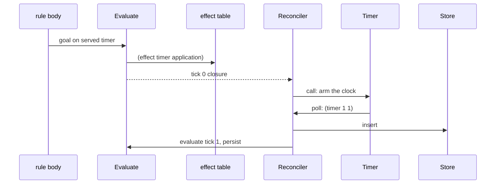

# The seam

[Example](#example) · [One Continuing request](#one-continuing-request) · [The trait](#the-trait) · [Rule](#rule) · [Receipts](#receipts)

## Example

`fixtures/reconcile/0_timer.dl7` keeps a 1 ms timer for two ticks (the program is in [Running dl8](../1_run.md)): tick 0 evaluates the program and writes the `effect` row; each later tick drains the clock and evaluates again:

```console
$ bash book/show.sh run fixtures/reconcile/0_timer.dl7 --serve timer --max-ticks 2
(effect timer ref(application(timer, [1 none])))
(timer 1 1)
(timer 1 2)
(Fired 1)
(Fired 2)
(FiredCount 1)
(FiredCount 2)
ticks 2
exit 0
```

```
step 0  tick 0  goal (timer ?Period ?Tick) on a served relation       -> effect row, application [1 none]
step 1  tick 1  Timer::call arms the 1 ms clock; poll drains the fire -> (timer 1 1)
step 2  tick 1  evaluate                                              -> (Fired 1), (FiredCount 1)
step 3  tick 2  the clock fires again                                 -> (timer 1 2), (Fired 2), (FiredCount 2)
step 4  after 2  --max-ticks                                          -> stop
```

Without `--max-ticks` the ticks keep coming while the timer row is live: a Continuing executor never settles.

## One Continuing request



| message | line |
|---|---|
| a served goal that heads no rule writes `effect` on every evaluation | `src/_6_eval/_5_evaluate.rs:244-249`, `:261-276` |
| `--serve` names fill `Program.served` from the flat name table | `src/_6_eval/_6_json.rs:346-369` |
| the reconciler reads effect rows past `effects_seen` | `src/_9_runtime/_2_reconcile.rs` |
| `call` starts work; the answering loop settles on the runtime's wake, then drains every service | `_2_reconcile.rs` |
| a Once application whose data row exists is skipped | `_2_reconcile.rs` |
| answers insert, then one evaluation and one persist per tick | `_2_reconcile.rs` |

A Once executor's work runs inside `call` and lands in the same settle: the comptime loop keeps one `Answerer` and waits on it synchronously, so a loaded document's rows exist before check reads them.

## The trait

```console
$ sed -n 12,53p src/_9_runtime/_2_reconcile.rs
#[derive(Copy, Clone, PartialEq, Eq, Debug)]
pub enum Cadence {
    /// One answer per application, never asked again.
    Once,
    /// Armed by an application, then rows arrive on the executor's own clock.
    Continuing,
}

/// One service answers the `effect` rows of one served relation.
pub trait IService {
    fn relation(&self) -> &str;
    fn cadence(&self) -> Cadence;
    /// Starts work for the applications this service has not seen. A
    /// synchronous service finishes here and buffers its rows; an asynchronous
    /// one spawns tasks holding plain data on the shared runtime. A service
    /// that watches the store (`http.serve` reads `http.response` rows) also
    /// sees it here: the answering loop calls with an empty `pending` once per
    /// tick.
    fn call(&mut self, u: &mut Universe, rows: &Store, pending: &[TermId]);
    /// Buffered and task-finished rows, drained without blocking. Terms are
    /// minted here, on the tick thread, so `Universe` never crosses threads.
    fn poll(&mut self, u: &mut Universe) -> Vec<Row>;
    /// Tasks started by `call` and not yet drained.
    fn in_flight(&self) -> usize {
        0
    }
    /// A Continuing service with at least one live clock.
    fn armed(&self) -> bool;
    /// Signed rows from a Continuing service's clock, retractions included.
    fn poll_signed(
        &mut self,
        u: &mut Universe,
        _timeout: Duration,
    ) -> Vec<crate::_6_eval::ir_eval::SignedRow> {
        self.poll(u)
            .into_iter()
            .map(|row| crate::_6_eval::ir_eval::SignedRow { row, weight: 1 })
            .collect()
    }
    /// Release an application whose request left the IR frontier.
    fn cancel(&mut self, _u: &Universe, _application: TermId) {}
}
```

## Rule

- An executor is one Rust value implementing `IService`; `relation()` names the served relation it answers.
- `call` starts work and never blocks on it. A Once executor does its work inside `call` and buffers the rows; an async executor spawns one task per request on the process-wide tokio runtime, and the task signals the loop's wake when its answer is on the channel.
- The answering loop settles Once work: bounded waits between drains until nothing is in flight or the 30-second budget expires; `poll` then drains every service without blocking.
- `Cadence::Continuing` arms on an application; later rows come from `poll`, and the tick loop's idle branch is one bounded wait on the same wake instead of a spin.
- `call` with an empty `pending` is a handout: `http.serve` reads `http.response` rows there and hands each to its waiting connection task.
- Signed rows: `fs.watch` replaces a file body at weight -1 then 1, and `http.serve` retracts a request row when its answer lands. The batch `run` store cannot retract; only the live IR host applies negative rows.
- Every error relation is declared by the program and looked up by name (`src/_9_runtime/_3_executors/mod.rs:169-298`); `http.fetch` has none, because its transport failure is status 0 in the row itself.
- Nothing compares the declared columns with the executor's columns: a user `timer` with one str column is served and never answered ([Namespacing](../modules/4_namespacing.md), `probes/9_user_timer_rule.dl7`).
- The run ends when a tick inserts nothing and no executor is armed, or at `--max-ticks` (`_2_reconcile.rs`).

## Receipts

| claim | path | command |
|---|---|---|
| two timer fires, evaluate reads both | `fixtures/reconcile/0_timer.dl7` | this page's console block |
| no executor, no error relation | `tests/_17_reconcile.rs:291-326` | `cargo test --test _17_reconcile` |
| the effect row and its application | [Effects](../10_effects.md) | `bash book/show.sh eval fixtures/host_effect/0_pending.dl7 --serve http.fetch` (regold pending: the fixture still declares `fetch_json`) |
