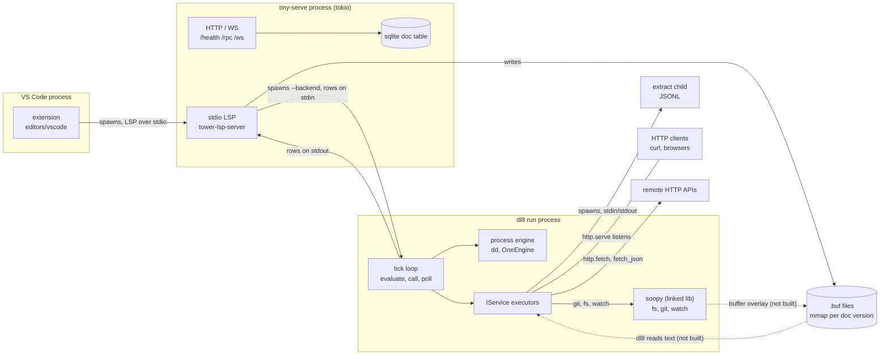
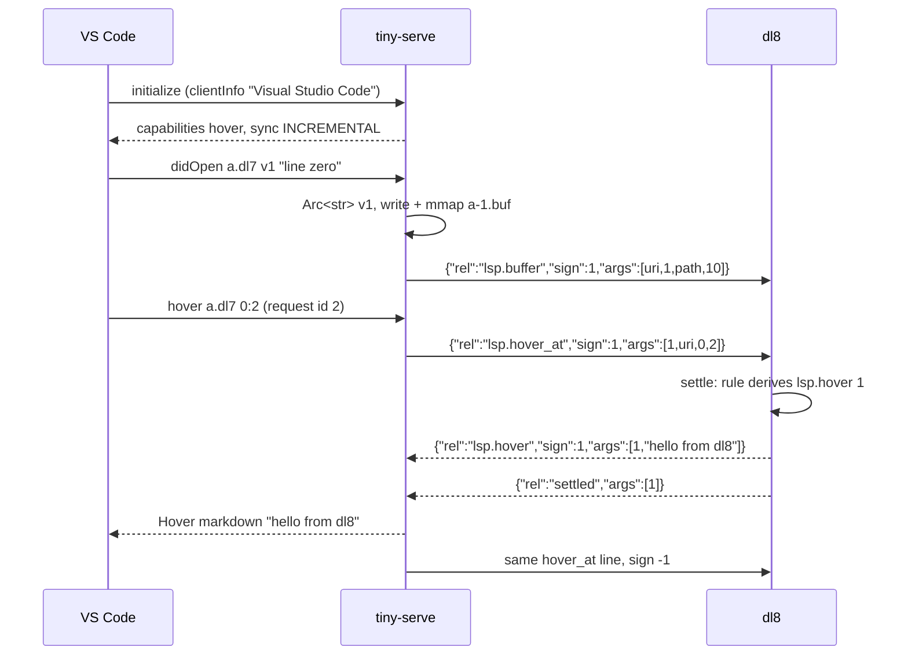
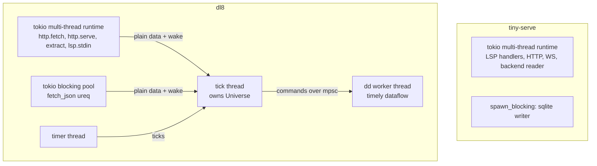
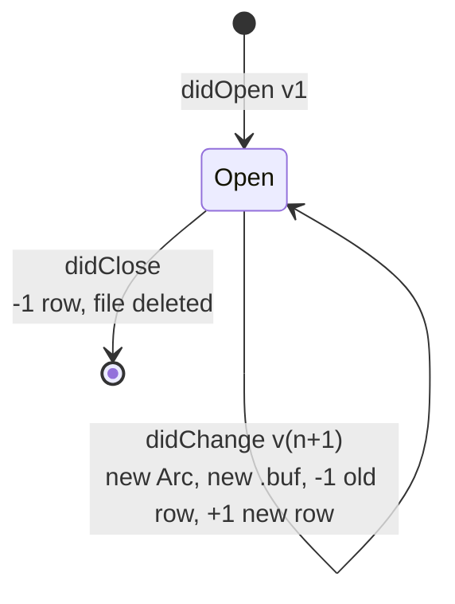
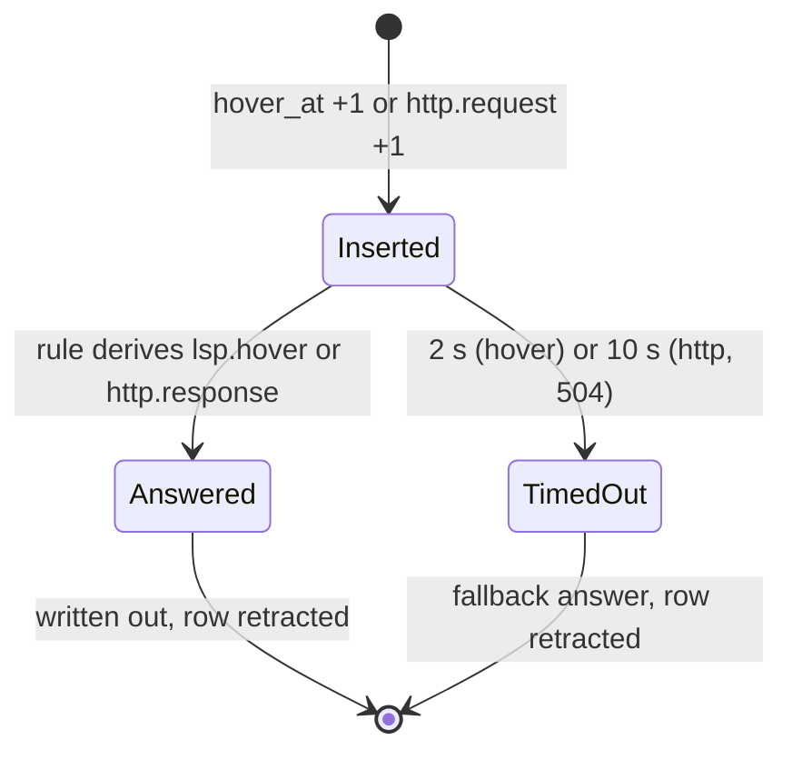

# Topology, 2026-10-07

State at sprefa main `96a83e48d`, tiny-serve main `a3784c3`, hafley-rs main `b32bd917`.
Dashed edges are not built.

## 1. Processes: who spawns whom, who is client to whom



| edge | client | server | wire |
|---|---|---|---|
| VS Code → tiny-serve | extension | tiny-serve `--stdio` | LSP JSON-RPC, Content-Length frames |
| tiny-serve → dl8 | tiny-serve | dl8 `run --serve lsp.stdin` | JSONL signed rows, one per line |
| dl8 → tiny-serve | dl8 | tiny-serve reader task | JSONL signed rows + `settled` |
| curl → dl8 | HTTP client | dl8 `http.serve` (hyper) | HTTP/1.1 |
| dl8 → web | dl8 `http.fetch` (reqwest), `fetch_json` (ureq on the blocking pool) | remote | HTTP |
| dl8 → extract | dl8 | `ryi` / extract child | JSONL |
| dl8 → soopy | in-process calls | | Rust API, `Arc<[u8]>` bytes |

## 2. One hover, end to end



## 3. Inside dl8: compile, then run

```mermaid
flowchart LR
  read["read + import chain"] --> macro["macrotime waves"]
  macro --> lower["lower<br/>kept per unit key"]
  lower --> check["check<br/>kept, per-rule re-resolve"]
  check --> comptime["comptime rounds<br/>on OneEngine"]
  comptime --> out["compiled program JSON"]
  out --> run["dl8 run"]
  run --> loop["tick: evaluate"]
  loop --> call["call: start effects"]
  call --> poll["poll / poll_signed: drain rows"]
  poll --> loop
```

## 4. Threads and runtimes



Terms are minted only on the tick thread; tasks hand back strings, bytes and numbers.

## 5. Lifetimes





## 6. Products on the wire

| product | columns | written by | read by |
|---|---|---|---|
| `lsp.buffer` | uri, version, path, bytes | tiny-serve | dl8 rules |
| `lsp.hover_at` | id, uri, line, character | tiny-serve | dl8 rules |
| `lsp.hover` | id, markdown | dl8 rules | tiny-serve |
| `lsp.diagnostic` | uri, start_line, start_char, end_line, end_char, severity, message | dl8 rules | tiny-serve (per-uri multiset, publishDiagnostics) |
| `http.request` | id, method, path, query, body | `http.serve` | dl8 rules |
| `http.response` | id, status, content_type, body | dl8 rules | `http.serve` |

## 7. Not built

| gap | where |
|---|---|
| dl8 reads `.buf` text into rows | dl8 executors |
| soopy buffer overlay | hafley-rs `crates/soopy` |
| dl8 stdout writer diffs the full closure per settle | `src/bin/dl8.rs` run path |
| `http_ws::not_found` flaky, 1 failure in 6 runs | tiny-serve `tests/http_ws.rs:169` |
| definition, references, completion, symbols | tiny-serve + dl8 rules |
